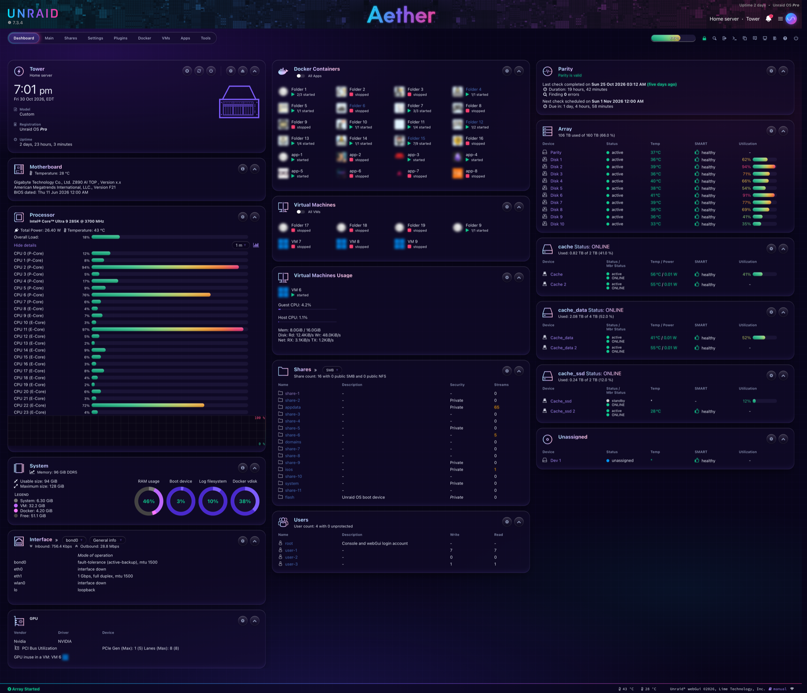
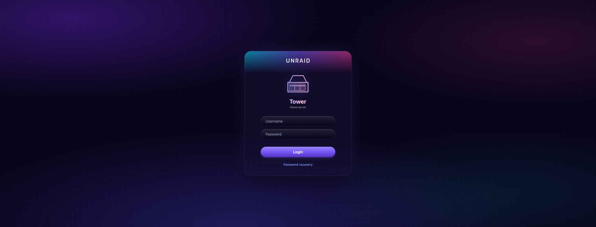
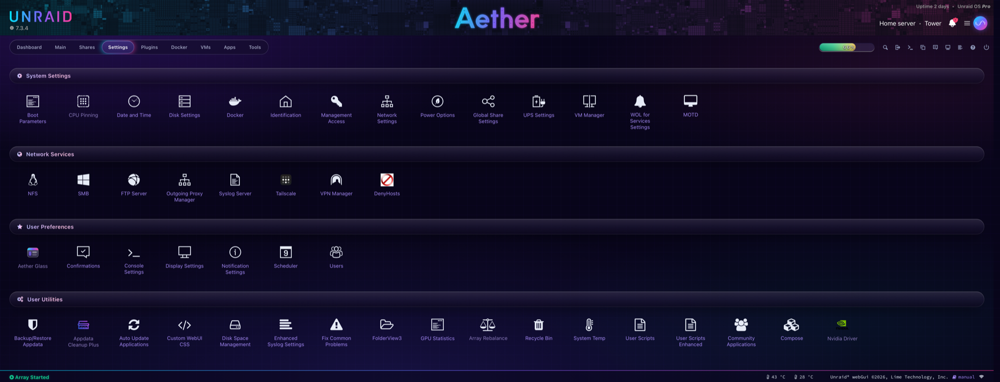

#  Aether Glass

A deep-violet frosted-glass theme for the Unraid webGUI.

> **Unofficial.**  Aether Glass is a community theme.  It is not made, endorsed or supported by Lime Technology.  "Unraid" is a trademark of Lime Technology, Inc.



| Login | Settings |
|---|---|
|  |  |

<sub>Screenshots use anonymized data.</sub>

## What it changes

- **Look:** a violet aurora behind frosted-glass panels, cyan → violet → pink accents, the system font (SF Pro on Apple devices, Segoe UI on Windows).
- **Status colours:** sea green for normal, amber for warning, crimson rose for critical, with soft glows.
- **Controls:** pill buttons and fields, macOS-style toggles, a segmented glass main menu.
- **Pages covered:** every normal page, the login page, the reboot and shutdown page, and the pop-up log windows plugins open (for example a "Downloading Package" window).

It is CSS only.  It changes how pages look and nothing else: the array, Docker, VMs, shares and data are not touched.  The worst case is a page that looks wrong, and the Settings page or the kill switch puts it back to stock.

## Requirements

- Unraid **7.2 or newer**.  Tested on **7.3.4**.
- Display theme set to **Black**: `Settings → Display Settings → Dynamix color theme`.  On another theme, normal pages stay stock and only the login page is themed.

## Install

1. **Make** a flash backup first: `Main → Boot Device → Flash → Flash Backup`.
2. **Open** `Plugins → Install Plugin` and paste:

   ```
   https://raw.githubusercontent.com/aegisnir/Aether-Glass-Unraid-Theme/main/aether-glass.plg
   ```

3. **Open** `Settings → Aether Glass` and click **Approve this version and turn on**.  The theme stays off until you do.
4. **Reload** the page.  If it still looks stock, reload while holding Shift.

## Dev channel (optional)

New changes land on the `dev` branch first and are tested there before they reach `main`.  `main` is always the default: the install link above, and Community Apps.  If you'd like to try changes early, install the dev build instead:

```
https://raw.githubusercontent.com/aegisnir/Aether-Glass-Unraid-Theme/dev/aether-glass.plg
```

- It replaces your normal install (same plugin, so the two never run together) and from then on updates from `dev`.  Its version ends in `-dev`, so `Plugins` shows which channel you're on.
- Dev builds can have rough edges.  Please report them in the issues.
- To go back, install the `main` link above.  Your settings are kept.  If the dev build is newer than the current release, you stay on that version until the next release passes it.

## Settings page

`Settings → Aether Glass` shows the Unraid version, the approved version, the kill switch, whether the Display theme is Black, and which pages are themed.

| Button | Does |
|---|---|
| Approve this version and turn on | records the current Unraid version as approved and applies the theme |
| Turn off | switches the kill switch on and goes back to stock, also after reboots |
| Turn back on | switches the kill switch off and applies the theme again, if this version is approved |

## Safety features

- **Pauses after Unraid updates.**  The theme only loads on the Unraid version you approved.  After an update it stays off, a notification says so, and you check the stock pages before approving the new version.  A webGUI change in a new release can't leave you with a broken-looking UI you didn't choose.
- **Kill switch.**  If the file `config/plugins/aether-glass/DISABLED` exists on the flash drive, the theme never loads.  It works even with the flash drive plugged into another computer.
- **Exact restore.**  Before changing anything, the plugin saves untouched copies of Unraid's original files in memory.  Turning the theme off or uninstalling copies them back byte for byte.
- **Nothing on the flash drive changes.**  The theme is added to the copies of the webGUI files that Unraid loads into memory at boot.  Unraid's own files on the flash drive are never edited, so every boot starts from stock.
- **Downloads are verified.**  Each file the plugin downloads is checked against a SHA256 fingerprint in the `.plg`.  A file that doesn't match is refused.

## Uninstall

`Plugins → Installed Plugins → Aether Glass → Remove`.  The webGUI goes back to stock right away, and the plugin deletes its own files from the flash drive and from memory.

## If the webGUI won't load

This should never happen from a CSS theme, but just in case:

1. **Shut down** the server and plug the flash drive into another computer.
2. **Create** an empty file named `DISABLED` in `config/plugins/aether-glass/`.
3. **Put** the flash drive back and boot.  The theme won't load.  Delete the file later to allow it again.

## Compatibility

| Tested with | Version |
|---|---|
| Unraid | 7.3.4 |
| Community Applications | 2026.07.21 |

The theme also styles a few popular plugins.  Those rules only match when the plugin is installed and do nothing otherwise:

- **Community Applications:** the Apps page cards, side panel and spotlight.
- **Dynamix System Buttons:** the header power button and its menu icon.
- **FolderView3:** folder boxes and dropdowns on the Docker and VMs pages.
- **Nvidia Driver** and other plugins that open a pop-up log window: the window is themed.

**Known conflicts:**

- **Custom WebUI CSS** (or any plugin that adds its own CSS) loads after this theme and wins.  Clear it out if something looks half-themed.
- **Other theme plugins** that change the same stylesheets.  Use one theme plugin at a time.

**Browsers:** current Safari, Chrome, Edge and Firefox.  Dropdown menus in Safari are drawn by macOS, so their highlight follows the system accent colour.

## How it works

Unraid unpacks its webGUI into memory at every boot and reinstalls plugins from `/boot/config/plugins/`.  At each boot this plugin:

1. Checks that this Unraid version is approved and the kill switch is off.
2. Saves untouched copies of three webGUI files in `/tmp`.
3. Appends the theme to `themes/black.css` (normal pages) and `default-cases.css` (the login page, which loads no other stylesheet), and inserts a `<style>` block into `logging.htm` (the pop-up log window).  Each addition sits between `AETHER-GLASS-START` and `AETHER-GLASS-END` markers.

Results go to the system log under the tag `aether-glass`:

```bash
grep aether-glass /var/log/syslog
```

## For maintainers: releasing

Two channels, chosen by the branch you're on.  `tools/release.sh` sets the update link and file source in the `.plg` to match, and adds `-dev` to dev versions.

One-time setup per clone, so the push guard below runs (GitHub Desktop runs it too):

```
git config core.hooksPath tools/hooks
```

**Dev build** (on `dev`)
1. **Edit** files in `source/`.
2. **Run** `tools/release.sh 2026.11.02`.  The `.plg` becomes `2026.11.02-dev`, updating from the `dev` branch.
3. **Add** a line under `<CHANGES>` in the `.plg`.
4. **Commit** and **push** `dev`.  No tag: dev builds download straight from the branch.

**Release** (to everyone)
1. **Merge** `dev` into `main`.
2. **Run** `tools/release.sh 2026.11.02` on `main`.  It refuses to keep a `-dev` version and points the `.plg` back at `main` and the tag.
3. **Commit**, then **tag** that commit with the same version **before pushing**: `git tag 2026.11.02`.  The `.plg` downloads its files from that tag, so a release pushed without it fails to install.
4. **Push** the commit and the tag: `git push && git push --tags`.
5. **Check** the tag is on GitHub and each file in the `.plg` downloads with a matching SHA256.
6. **Merge** `main` back into `dev`, then run `tools/release.sh` on `dev` so it's a dev build again.

The push guard (`tools/hooks/pre-push`) stops a push to `main` while its `.plg` still has a `-dev` version or links to the `dev` branch.  That's the one mistake that would move every user onto the testing channel.

Changes that don't touch `source/` or the `.plg` (README, screenshots, tools) need no new version and no tag.

## License

MIT, see [LICENSE](LICENSE).  No Lime Technology artwork is included: the header wordmark is recoloured using a mask of the logo file already on your server.
